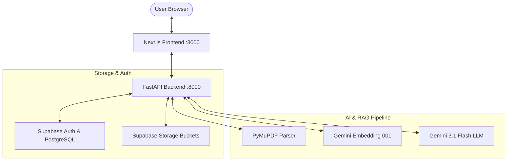

# Enterprise RAG Knowledge Base

[](https://www.python.org/)
[](https://fastapi.tiangolo.com/)
[](https://nextjs.org/)
[](https://ai.google.dev/)
[](https://supabase.com/)
[](LICENSE)

A production-ready Enterprise **Retrieval-Augmented Generation (RAG)** platform featuring multi-document parsing (PDF, DOCX), verified page citations, private user-isolated workspaces, Supabase authentication with real email verification, and Role-Based Access Control (RBAC).

---

## 🌟 Key Features

- **📑 Pinpoint Page Citations:** Every AI answer includes verified source citations down to the exact document filename and page number using PyMuPDF page extraction.
- **🔒 Multi-User Document Isolation:** Each user has their own private document workspace. Documents and embeddings uploaded by one user are never visible or searchable by other users.
- **⚡ Google Gemini 3.1 & Vector Embeddings:** Powered by Google's `gemini-3.1-flash-lite` and `gemini-embedding-001` with Matryoshka dimension reduction (768-dim) and in-memory vectorized similarity caching for sub-second retrieval.
- **🛡️ Supabase Authentication & Real Email Verification:** User registration with Supabase Auth, email confirmation enforcement, and JWT session handling.
- **👥 Role-Based Access Control (RBAC):**
  - **Admin:** Full system control, document management, and user role management (`/admin`).
  - **Editor:** Document ingestion, deletion of owned documents, and RAG chat.
  - **Viewer:** Read-only access to query documents and view verified citations.
- **🎨 Modern Responsive UI:** Next.js (App Router), Tailwind CSS, Lucide Icons, and client-side route guards.

---

## 🏗️ Architecture Overview



---

## 📁 Repository Structure

```text
rag-knowledge-base/
├── frontend/                        # Next.js 14 (App Router + Tailwind CSS)
│   ├── src/
│   │   ├── app/
│   │   │   ├── (auth)/              # Secure Login & Register with Verification
│   │   │   ├── (dashboard)/
│   │   │   │   ├── chat/            # RAG Chat Interface with Citation Pills
│   │   │   │   ├── documents/       # Drag-and-drop Document Upload & Management
│   │   │   │   └── admin/           # RBAC User Management Table
│   │   │   └── layout.tsx
│   │   ├── components/              # Modular UI & Chat components
│   │   ├── lib/                     # Axios API client & Supabase client
│   │   └── types/                   # TypeScript interfaces
│   ├── .env.local.example
│   └── package.json
│
├── backend/                         # FastAPI Backend
│   ├── app/
│   │   ├── api/
│   │   │   └── routes/
│   │   │       ├── auth.py          # Supabase Auth, JWT & Role management
│   │   │       ├── documents.py     # User-isolated Document upload & delete
│   │   │       └── chat.py          # RAG query execution & citation formatting
│   │   ├── core/                    # Security, Config & Supabase admin client
│   │   ├── services/
│   │   │   ├── parser.py            # PDF & DOCX text and page extractor
│   │   │   ├── embeddings.py        # 768-dim Matryoshka vector embeddings
│   │   │   └── rag_engine.py        # Vector similarity search & LLM generation
│   │   ├── schemas/                 # Pydantic request & response models
│   │   └── main.py                  # Application entry point & CORS
│   ├── requirements.txt
│   └── .env.example
│
├── .gitignore                       # Production gitignore protecting secrets
└── README.md
```

---

## 🚀 Getting Started

### Prerequisites

- **Python:** 3.11+
- **Node.js:** 18.0+ & npm / pnpm
- **Supabase Account:** Free tier project with Auth and Storage
- **Google AI Studio API Key:** For Gemini LLM & Embeddings

---

### 1. Backend Setup

```bash
# Navigate to backend directory
cd backend

# Create and activate virtual environment
python -m venv venv

# Windows:
.\venv\Scripts\activate
# Linux / macOS:
# source venv/bin/activate

# Install dependencies
pip install -r requirements.txt

# Configure environment variables
copy .env.example .env   # On Windows
# cp .env.example .env   # On Linux/macOS
```

Edit `backend/.env` with your credentials:

```env
# Gemini API Key
GEMINI_API_KEY="your-gemini-api-key"
GOOGLE_API_KEY="your-gemini-api-key"

# Supabase Credentials
SUPABASE_URL="https://your-project.supabase.co"
SUPABASE_SERVICE_ROLE_KEY="your-supabase-service-role-key"

# Special Role Accounts
ADMIN_EMAIL="admin@ragkb.com"
EDITOR_EMAIL="editor@ragkb.com"
ADMIN_INITIAL_PASSWORD="AdminPassword123!"
EDITOR_INITIAL_PASSWORD="EditorPassword123!"
```

Start the backend server:

```bash
python -m uvicorn app.main:app --reload --port 8000
```

> **API Documentation:** Interactive Swagger docs are available at `http://localhost:8000/docs`.

---

### 2. Frontend Setup

In a new terminal:

```bash
# Navigate to frontend directory
cd frontend

# Install dependencies
npm install

# Configure environment variables
copy .env.local.example .env.local   # On Windows
# cp .env.local.example .env.local   # On Linux/macOS
```

Edit `frontend/.env.local`:

```env
NEXT_PUBLIC_API_URL=http://localhost:8000/api/v1
NEXT_PUBLIC_SUPABASE_URL=https://your-project.supabase.co
NEXT_PUBLIC_SUPABASE_ANON_KEY=your-supabase-anon-key
```

Start the frontend development server:

```bash
npm run dev
```

Open **`http://localhost:3000`** in your browser.

---

## 🔑 Default Accounts

On backend startup, the following special accounts are automatically initialized in Supabase Auth:

| Role | Email | Password | Permissions |
| :--- | :--- | :--- | :--- |
| 🛡️ **Admin** | `admin@ragkb.com` | `AdminPassword123!` | System Root, User Management, Document Upload/Delete, Chat |
| ✍️ **Editor** | `editor@ragkb.com` | `EditorPassword123!` | Document Upload/Delete, RAG Chat |
| 👤 **User** | Self-registered | Set by user | Private Document Ingestion & RAG Chat with verified citations |

---

## 🛠️ Key API Endpoints

| Method | Endpoint | Description | Access |
| :--- | :--- | :--- | :--- |
| `POST` | `/api/v1/auth/register` | Register new user & dispatch verification email | Public |
| `POST` | `/api/v1/auth/login` | Authenticate with Supabase Auth & obtain JWT | Public |
| `GET` | `/api/v1/auth/me` | Fetch authenticated user profile | Authenticated |
| `GET` | `/api/v1/auth/users` | List all registered users and RBAC status | Admin only |
| `PUT` | `/api/v1/auth/users/{id}/role`| Change user role (Admin/Editor/Viewer) | Admin only |
| `GET` | `/api/v1/documents` | List user-owned documents (Admin sees all) | Authenticated |
| `POST` | `/api/v1/documents/upload` | Upload & index PDF/DOCX documents | Authenticated |
| `DELETE`| `/api/v1/documents/{id}` | Delete document and vector chunks | Owner / Admin |
| `POST` | `/api/v1/chat/query` | RAG query with page citations & user isolation | Authenticated |

---

## 📄 License

This project is licensed under the [MIT License](LICENSE).
